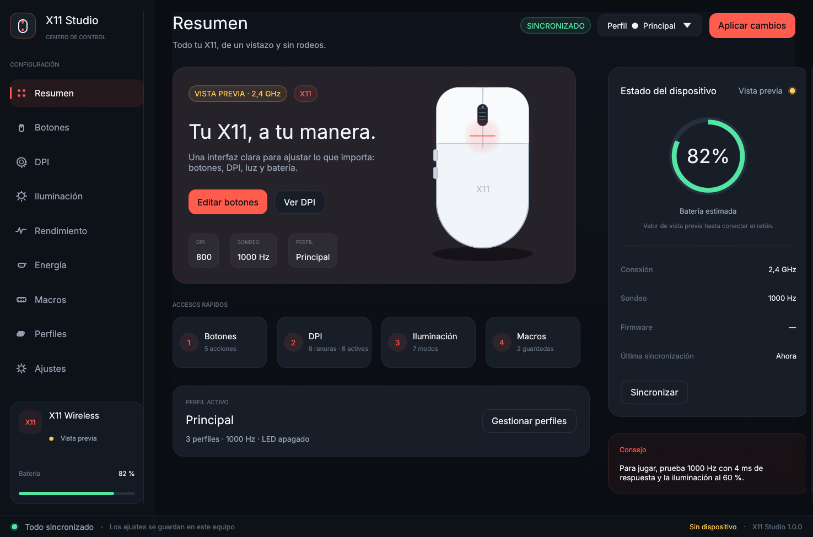

# X11 Studio

Centro de control de escritorio para el **Attack Shark X11** (`1D57:FA60` / `1D57:FA55`), reconstruido en **Rust + egui** con una interfaz más clara y fluida que el software original.



## Estado

La aplicación ya no es solo una vista previa: habla con el receptor del ratón por HID.

- **Lectura real** de DPI, sondeo, iluminación, mapa de botones, perfil activo y batería.
- **Escritura real** de DPI y colores por etapa, etapa activa, sondeo, iluminación, brillo, velocidad, color, temporizadores de energía, respuesta de clic, mapa de botones, macros y perfil activo.
- **Batería real** a partir del informe de eventos `03 <id> 40|41 <estado> <porcentaje>`.
- Verificado contra un X11 físico con una prueba de ida y vuelta: se lee cada informe, se escribe exactamente lo mismo y se comprueba la lectura posterior sin alterar ningún ajuste.

## Funciones de la interfaz

- Resumen con estado del dispositivo, batería y accesos rápidos.
- Mapa visual del ratón con los cinco botones físicos y su byte de comando.
- Ocho ranuras de DPI, seis activas de fábrica, con colores por etapa y etapa de arranque.
- Siete modos de iluminación, brillo, velocidad y 16 colores predefinidos.
- Sondeo de 125/250/500/1000 Hz, debounce, ripple, angle snap, motion sync y lift-off.
- Temporizadores de apagado de luz y suspensión.
- Editor de macros con grabación de teclas, duración, orden y repetición.
- Perfiles con duplicado, renombrado, eliminación, importación y exportación JSON.
- Español e inglés, cuatro acentos y atajos `Ctrl+S` (aplicar), `Ctrl+Z` (descartar) y `Esc` (cerrar).

## Requisitos

- Rust estable con soporte para edition 2024 (probado con 1.99).
- Windows 10 u 11 para la experiencia principal. El transporte HID también compila en Linux y macOS, pero solo se ha probado en Windows.
- Visual Studio Build Tools con el enlazador de MSVC. El proyecto incluye `app/.cargo/config.toml` para localizarlo.

## Compilar y ejecutar

```bash
cd app
cargo run            # desarrollo
cargo build --release
target/release/x11-studio.exe
```

El estado se guarda en `%APPDATA%\X11Studio\state.json`.

### Capturas automáticas

```bash
target/release/x11-studio.exe --tab dpi --screenshot shots/dpi.png
```

Valores válidos de `--tab`: `overview`, `buttons`, `dpi`, `lighting`, `performance`, `power`, `macros`, `profiles`, `settings`.

## Pruebas

```bash
cd app
cargo test
```

Las pruebas cubren la curva de DPI, los valores de fábrica, la migración del estado, los informes HID (DPI, sondeo, iluminación, botones y macros), las sumas de comprobación y el análisis de los eventos de batería.

Prueba de hardware de solo lectura:

```bash
cargo run --bin hid_probe
```

Prueba de escritura segura: lee cada informe, reescribe exactamente los mismos bytes y verifica la lectura posterior.

```bash
cargo run --bin hid_probe -- --write-test
```

## Protocolo HID

El X11 expone tres colecciones en la interfaz 2:

| Uso | Página | Propósito |
|---|---|---|
| Comandos | `0x000B` | Informes de configuración (`SET/GET_FEATURE`) |
| Eventos | `0x000A` | Batería, cambios de DPI o perfil y confirmaciones |
| Consumidor | `0x000C` | Atajos multimedia y de navegador |

Informes usados (incluyen el identificador en el byte 0):

| ID | Tamaño | Contenido |
|---|---|---|
| `0x04` | 56 | DPI por etapa, etapa activa, colores, LOD, angle snap, motion sync y ripple |
| `0x05` | 15 | Iluminación, brillo, velocidad, color, suspensión profunda, suspensión y respuesta de clic |
| `0x06` | 9 | Sondeo (`08/04/02/01` = 125/250/500/1000 Hz) |
| `0x08` | 59 | 18 ranuras de botones (3 bytes por ranura) |
| `0x09` | 3×64 | Macro en tres páginas |
| `0x0C` | 10 | Perfil activo y número de perfiles |

Las lecturas requieren el protocolo de permiso `A0 <id> <longitud> 00 01 00 00 00` y después leer `A0` hasta recibir `A0 01`.

La hoja de mecánicas del programa original (direcciones de función, valores de fábrica y reglas del fabricante) está en [`app/MECHANICS.md`](app/MECHANICS.md). Los informes de escritura se contrastaron con el protocolo público de la comunidad:

- <https://github.com/HarukaYamamoto0/attack-shark-x11-driver>
- <https://github.com/kababyte/attackshark-x11prov2>

## Estructura

```
app/
  src/
    app.rs       interfaz, pantallas y ventanas modales
    hardware.rs  transporte HID, informes y pruebas
    model.rs     perfiles, comandos, macros y estado
    theme.rs     tema y componentes visuales
    art.rs       ilustración vectorial del ratón
  src/bin/hid_probe.rs  diagnóstico de hardware
  MECHANICS.md          mecánicas verificadas del programa original
```

## Licencia

MIT. Este proyecto no está afiliado a Attack Shark.
